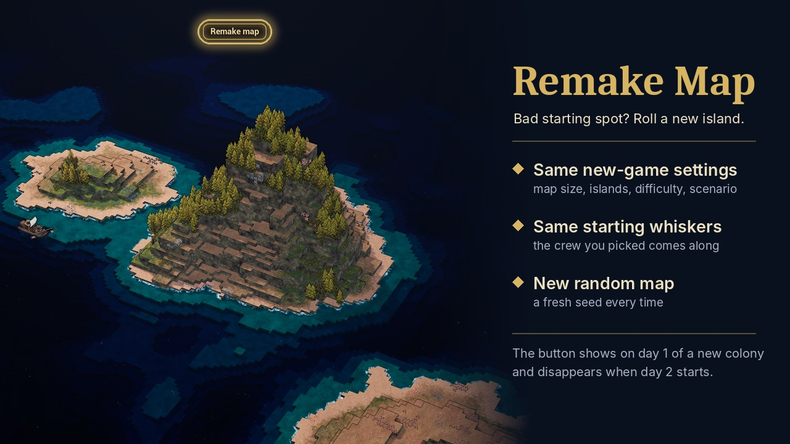

# Remake Map

A quality-of-life mod for [Whiskerwood](https://store.steampowered.com/app/2489330/Whiskerwood/).

Rolled a bad starting island? Starting over normally means going back to the menu, setting everything up
again and losing the starting whiskers you picked. This mod adds a **Remake map** button on the first day of
a new colony: it restarts with the **same new-game settings** and the **same starting whiskers** on a
**new random map**.

## Features

- Same new-game settings: map size, island sizes, extra and barren islands, scenario, difficulty and every other choice.
- Same starting whiskers.
- New map every time: the mod rolls a new map seed (the game keeps the seed among the new-game settings,
  so restarting without a new seed would rebuild the exact same island).
- Two clicks: the first arms the button (*Click again to remake the map*), the second remakes.
- The button sits above the bottom toolbar on day 1 of a new colony and is removed when day 2 starts. It lives in
  the same part of the game UI as the toolbar, so loading screens and menus cover it.
- Save names like the game's own: the remade colony is saved as `<Colony>_<Roman numeral>`, counting the maps:
  the original is `Airhaven`, the first remake `Airhaven_II`, the next `Airhaven_III`, … (autosaves `Airhaven_II_autosave`).
  A numeral whose save already exists (an older colony with the same name) is skipped, so no save is overwritten.
- Does nothing in the background: it reacts to the button and the day change only.

## Installing

- **Steam Workshop:** subscribe.
- **Manually:** put `RemakeMap.pak` and `RemakeMap.uplugin` in `%localappdata%\Whiskerwood\Saved\mods\RemakeMap\`.

## Known limitations

- No button after loading a save, even a day-1 save: the game only remembers the settings of the most
  recent new game, which may belong to another colony.
- The new colony keeps the same colony name.

## Repo layout

- `Mod/RemakeMap/` - modkit assets + `RemakeMap.uplugin` (the one that ships)
- `docs/graphs/` - Blueprint paste text (generated)
- `docs/preview.jpg` - Workshop preview (built by `tools/make_preview.py` from `docs/screenshot.png`)
- `tools/remakemap_build.py` - graph generator (`tools/t3d.py`, `tools/rm_common.py`)
- `workshop/` - `RemakeMap.vdf`, `HOW_TO_UPLOAD.md`
- `sync-from-modkit.bat`, `sync-to-steam.bat`

## Building from source

Generate the graphs: `JMAP=path/to/Whiskerwood-x.jmap.gz python tools/remakemap_build.py` → `tools/out/`.

Assets in `/Game/Mods/RemakeMap/` (modkit `Content/Mods/RemakeMap`):

| Asset | Type | Notes |
|---|---|---|
| BP_MapLoad | Actor Blueprint | paste `docs/graphs/BP_MapLoad.txt` |
| WBP_RemakeButton | Widget Blueprint (User Widget) | designer only: Button `Btn` with a TextBlock `Label` inside, both *Is Variable* |
| PAL_RemakeMap | Primary Asset Label | Chunk ID **30**, Label Assets in My Directory, Cook Rule Always Cook |

BP_MapLoad variables:

| Name | Type |
|---|---|
| Debug | Boolean |
| Ready | Boolean |
| SetupTries | Integer |
| Armed | Boolean |
| Button | WBP_RemakeButton (Object Reference) |
| Arco | Arco Systems (Object Reference) |
| NewSeed | Integer |
| NewRaw | Float |
| Placed | Boolean |
| HudTries | Integer |
| Hud | User Widget (Object Reference) |
| Level | Widget (Object Reference) **array** |
| Next | Widget (Object Reference) **array** |
| TB | Widget (Object Reference) |
| State | Generic Save Game (Object Reference) |
| RemakeNo | Integer |
| Taken | String |
| Numerals | String **array** |
| Picked | String |

Copy `Mod/RemakeMap/RemakeMap.uplugin` into the modkit folder before Cook & Install.

## How it works

- The new-game menu keeps its choices in the game's MetaSave (`ArcoGameInstance.GetMetaSave`): map extents,
  colony name, starting whiskers (`newStartingAgents`), debt difficulty and the map preferences
  (`newMapPreferenceNames` / `newMapRawPreferences`: scenario, map size, islands, … and `Seed`).
- Setup runs at BeginPlay (new games don't send `onLoadingFinished`) and at `onLoadingFinished`. The button is
  created when `ArcoSystems.IsSaveGame` is false and `WorldTime.m_day` is 1.
- It is placed next to the bottom toolbar. `GetAllWidgetsOfClass` only sees top-level widgets, so the mod takes
  `BP_PlayHud_C` (ForEachLoop over the result) and walks its widget tree level by level (panels → `GetAllChildren`,
  user widgets → `NaviUi.FindDecendentsOfClasses` with the concrete panel classes) until it meets the widget of class
  `BottomToolbar_C` ("Toolbar"). The button is added to its parent `HideableElements` (CanvasPanel): anchor and
  alignment bottom-centre, position (0, -400). The toolbar reports a desired size of 0, so a bar height of 100 is
  assumed. Until the toolbar exists and is visible, a one-shot 1 s timer retries (max 60). The walk runs once.
- Second click: `SetNewMapPreference("Seed", <random 1..9999999>, <random 0..1000>)`, then
  `ArcoGameInstance.EnterPlay(<save name>, NEW_GENERATION)`, the same call a new game uses. EnterPlay's file name
  becomes the save name (an empty one gives the game's `Unnamed_<date>`).
- Save name: the mod keeps a small state in `Saved\SaveGames\RemakeMap.sav` (a `SystemCore.GenericSaveGame`): the
  seed, colony name and number of the map it made last. If the current map's seed (the `Seed` preference in the
  MetaSave = the most recent new game) and colony match it, the current map is that remake and the next number is
  one higher; otherwise the current map is an original and the next number is II. The first numeral (I…C) from there
  whose `<Colony>_<numeral>` is not among `ArcoGameInstance.GetSaveGames` (`.whisker` / `_autosave` ignored) is used.
- `ModAPI.onDayStart` with day > 1 removes the button.

## Debug logging

Create `%localappdata%\Whiskerwood\Saved\mods\RemakeMapConfig\debug.txt` with any text (an empty file counts as off);
lines go to `Saved\Logs\modlog.txt` (colony state, where the button was placed, the new seed, the save name).

## Version history

- **1.2** - remade colonies are saved as `<Colony>_II`, `_III`, … instead of `Unnamed_<date>`.
- **1.1** - the button sits above the bottom toolbar and is covered by loading screens and menus like the rest of the game UI; mod-menu setting removed.
- **1.0** - first release.

## Credits

Made by rinku. Created using the [Whiskerwood modkit](https://github.com/Whiskerwood-Modding/Whiskerwood-Project).
